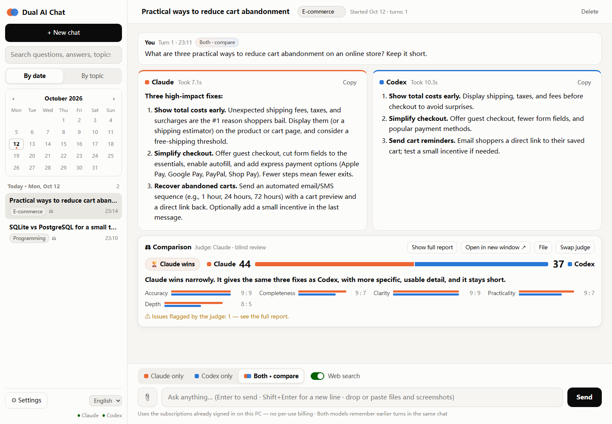
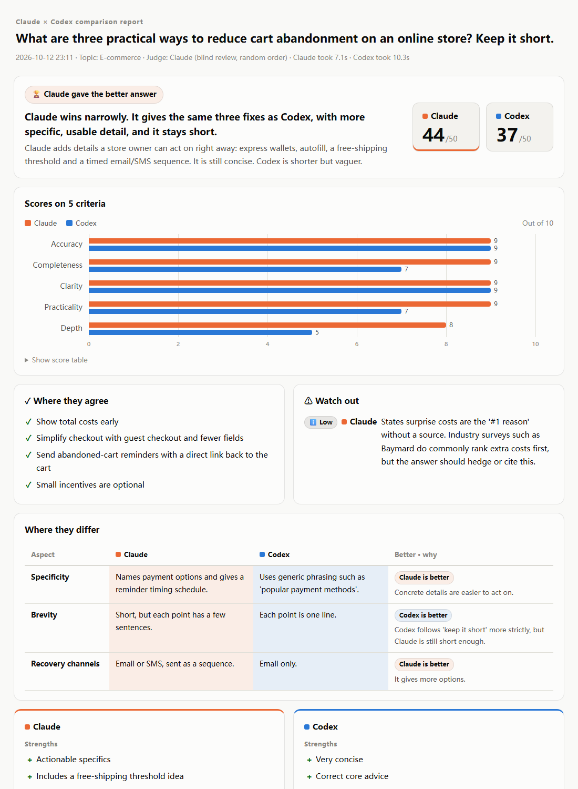

# デュアルAIチャット（Dual AI Chat）

**同じ質問を Claude と ChatGPT（Codex）に同時に聞き、2つの回答を並べて表示、自動で採点・比較してビジュアルなレポートを作ります。すでに契約しているサブスクをそのまま使います。**

[English](README.md) · [简体中文](README.zh-CN.md)



Windows で動くローカルの小さな Web アプリです。PC でログイン済みの公式 **Claude Code** と **Codex** のコマンドラインツールを使うので、API キーも従量課金も不要で、利用分は Claude / ChatGPT のプランにカウントされます。会話・添付ファイル・レポートはすべてあなたの PC の中だけに保存されます。

## 機能

- **3つの聞き方**：Claude だけ、Codex だけ、両方に聞いて比較。Claude は1文字ずつストリーミング、両方は並行して回答します。
- **匿名での比較**：審査役のモデルが正確性・網羅性・分かりやすさ・実用性・深さの5項目で採点し、共通点と相違点、誤りを整理して、**統合ベスト回答**を書きます。2つの回答は A / B として匿名化し順番もランダムにするので、身内びいきを抑えられます。
- **ビジュアルな HTML レポート**：チャット内に表示されるほか、単独のファイルとして保存され、開いたり共有したりできます。
- **記憶**：同じ会話の中では、もう一方のモデルだけに聞いた回も含めて、両モデルとも前の内容を覚えています。会話はすべて自動保存され、**日付別（カレンダー付き）**・**トピック別**に振り返れ、全文検索もできます。タイトルとトピックは自動で付きます。
- **添付ファイル**：ドラッグ＆ドロップ、またはスクリーンショットを Ctrl+V で貼り付け。画像・スクショ・**iPhone の写真（HEIC）**・PDF・Word・Excel・PowerPoint・テキスト / CSV / コードに対応し、文字を抽出して両モデルが読めるようにします。CSV は UTF-8 / Shift_JIS（楽天のエクスポートなど）/ GB18030 を自動判別します。
- **3つの表示言語**：日本語・简体中文・English。モデルは表示言語で回答し、レポートも合わせて切り替わります。
- 最新情報が必要な質問向けの **Web検索** スイッチ。



## 必要なもの

- インターネットにつながる Windows 10 / 11
- **Claude** のサブスク（Pro または Max）
- **Codex** が使える **ChatGPT** のサブスク（Plus、Pro など）

それ以外はインストーラーがすべて用意します。

## インストール（Windows・ワンクリック）

1. [**Releases**](https://github.com/tanktangmold/dual-ai-chat/releases/latest) から `dual-ai-chat-v<バージョン>.zip` をダウンロードし、**展開して**から決まった場所（例：`D:\dual-ai-chat`）に置きます。
2. **`install.bat`** をダブルクリック。「Windows によって PC が保護されました」と出たら「詳細情報」→「実行」。
3. ブラウザが2回開きます。まず **Claude** にログインし、次に **Sign in with ChatGPT** で Codex にログインします。
4. 「PDF / Word / Excel の読み取り」（約 60 MB）と「iPhone の写真（HEIC）」（約 100 MB）は必要に応じて追加できます。
5. 完了するとデスクトップに **デュアルAIチャット** のアイコンができます。

インストーラーの動き：

- **管理者権限は不要で、システムは変更しません。** 足りないものだけをアプリ内の `runtime\` フォルダにダウンロードします（ポータブル版 Node.js、npm 経由の Claude Code と Codex、オプションでポータブル版 Python〔PyMuPDF・python-docx・openpyxl〕と ffmpeg）。PC にすでにあるものはそのまま使います。フォルダを削除すればアンインストール完了です。
- **何度でも実行可能**：足りないものだけを追加し、ログインの期限が切れていればログイン画面を開き直します。ログは `data\install.log`。
- ダウンロード元に接続できない場合はミラーに切り替えます。

詳しい手順は [INSTALL.ja.txt](INSTALL.ja.txt) をご覧ください。

## ソースから実行

Node.js 22 以上と、インストール・ログイン済みの `claude` と `codex`（`claude auth login`、`codex login`）が必要です。npm の依存パッケージはありません。

```bash
git clone https://github.com/tanktangmold/dual-ai-chat.git
cd dual-ai-chat
node server.mjs --open
```

<http://127.0.0.1:8796>（ローカルのみ）で動きます。よく使うコマンド：

```bash
node server.mjs --check   # 見つかった claude / codex / ffmpeg / Python を表示（JSON）
npm test                  # ユニット＋統合テスト（ダミーモデルなので利用枠は消費しません）
npm run pack              # 配布用の dist/dual-ai-chat-v<バージョン>.zip を作成
```

macOS / Linux：サーバーは素の Node.js なので、`claude` と `codex` が `PATH` にあれば `node server.mjs --open` で動くはずですが、テストしているのは Windows だけで、ワンクリックインストーラーも Windows 専用です。

## 仕組み

- **Claude**：`claude -p --safe-mode --output-format stream-json --resume <セッション>`。ストリーミング出力、セッション再開による複数ターンの記憶。個人の Claude Code の設定・プラグイン・フックは読み込みません。
- **Codex**：`codex exec --json --ignore-user-config -c sandbox_mode=read-only`、続きは `codex exec resume <thread>`。
- **サブスクのみ**：子プロセスから `ANTHROPIC_API_KEY` / `OPENAI_API_KEY` を外し、API 課金ではなくサブスクのログインを使わせます。
- **審査役**：既定は Claude（推論レベル低・約 20 秒）。回ごとに「審査役を交代」できます。実測では Codex が審査役のとき自分の回答をやや高く評価する傾向があります。

## プライバシーとセキュリティ

- サーバーは `127.0.0.1` だけで待ち受け、`Host` ヘッダーを検査して DNS リバインディングを防ぎ、書き込み系のリクエストには独自ヘッダーと同一オリジンを必須にしています。
- モデルの出力は必ずエスケープしてから表示します。レポートは厳しい CSP 付きで配信し、サンドボックス化した iframe で表示します。
- Claude が読めるのはアプリのアップロードフォルダ内のファイルだけ（`Read(./uploads/**)`）で、Codex は読み取り専用のサンドボックスで動きます。
- 利用統計などは一切送信しません。もちろん、質問と添付ファイルは回答のために Anthropic / OpenAI に送られます。

## データの保存場所

すべてアプリフォルダ内の `data\` にあります：`conversations\`（会話ごとの JSON）、`reports\`（HTML レポート）、`workspace\uploads\`（添付ファイル）、`trash\`（削除した会話）、`settings.json`。

## 免責事項

これは独立した非公式プロジェクトで、Anthropic および OpenAI とは提携・承認・後援の関係にありません。「Claude」「Claude Code」は Anthropic の、「ChatGPT」「Codex」は OpenAI の商標です。ご自身のサブスクの利用規約に従ってお使いください。

## ライセンス

[MIT](LICENSE)
